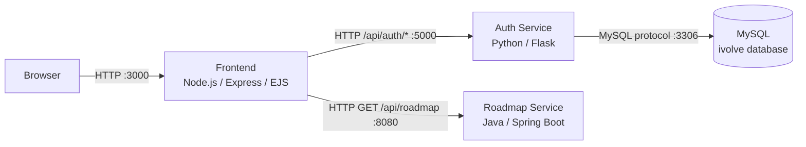

# Phase 1: Application Architecture and Implementation Plan

## Scope and source snapshot

This analysis is based on the public source repository `Ibrahim-Adel15/iVolveFinalProject`, cloned into this workspace at commit `def4818` (`Update README.md`). The checkout was shallow, but includes the complete tracked application tree at that commit. Phase 1 is source inspection only; no application code or infrastructure has been changed.

The original Phase 1 snapshot and findings remain historical. The current user-approved delivery decision is GitHub Actions for CI and Argo CD for CD to EKS. Jenkins and Ansible are not in the target architecture. The MySQL migration to encrypted EBS, Argo CD sync/health check, and Jenkins EC2 retirement are complete. The application namespace migration and Argo CD update are complete. The remaining project work is final handoff documentation and a final review of CI/deployment evidence; MySQL and its PVC remain in `default`. See `DELIVERY_ARCHITECTURE.md` for current status and prerequisites.

## Verified architecture

| Component | Verified implementation | Port | Configuration / API | Data dependency |
|---|---|---:|---|---|
| Frontend | Node.js 22 Alpine; Express 5, EJS, Axios, express-session | 3000 | `AUTH_SERVICE_URL`, `ROADMAP_SERVICE_URL`; `GET /`, `GET /signup`, `POST /signup`, `POST /login`, `GET /roadmap`, `POST /logout` | Auth and Roadmap HTTP APIs |
| Auth Service | Python 3.12; Flask 3.1.1, mysql-connector-python 9.4.0, bcrypt 4.3.0 | 5000 | Requires `DB_HOST`, `DB_PORT`, `DB_USER`, `DB_PASSWORD`, `DB_NAME`; `GET /health`, `POST /api/auth/signup`, `POST /api/auth/login` | MySQL; creates `users` table if missing |
| Roadmap Service | Java 21; Spring Boot 3.5.4, Spring Web | 8080 | `server.port=8080`; `GET /api/roadmap` | None; static response data |
| MySQL | External runtime dependency, expected database `ivolve` | 3306 | Credentials supplied to Auth Service | Stores `users` (`id`, `username`, `password_hash`, `created_at`) |

### Request and data flow

1. The browser submits login or signup forms to the Express frontend.
2. The frontend forwards JSON credentials to the Auth Service.
3. Auth checks or creates the account in MySQL. Passwords are stored as bcrypt hashes.
4. On login, the frontend stores the returned user object in an express-session cookie-backed session.
5. The frontend fetches roadmap data from the Java service and renders it through EJS.

Only the Auth Service needs direct database connectivity. MySQL should remain private to the application network. The frontend is the only externally exposed application service; Auth, Roadmap, and MySQL should use internal networking in Compose and Kubernetes.

## Source findings and risks

- The upstream README contradicts source: it labels Auth as Java and Roadmap as Python, gives incomplete/incorrect endpoint examples, and includes a plaintext-looking database credential example. Treat code as authoritative, do not repeat that credential, and correct documentation later.
- All three services already have Dockerfiles. The Roadmap Dockerfile is multi-stage; Frontend and Auth use single-stage images. The current images run as root and define no Docker `HEALTHCHECK`.
- Frontend listens on a hard-coded port and has no health endpoint. It has a weak fallback for `SESSION_SECRET`; deployment must provide a strong secret through a Kubernetes Secret/GitHub secret workflow. Its default express-session MemoryStore is not suitable for multiple replicas or durable sessions; this is a scaling limitation to document or address only if scope permits.
- Auth exposes `/health`, but it also calls `ensure_database_ready()`, which may create the table. The service initializes DB readiness on startup with retries. Database access therefore needs the DDL permission required for `CREATE TABLE` at startup, unless schema creation is separated in a future, justified change.
- Roadmap has no health endpoint or Actuator dependency. For Kubernetes probes, either use a TCP probe on port 8080 or make a small justified health endpoint change later; do not invent `/health` as if it exists.
- Runtime ports and hostnames are not configurable for the application listeners today. Compose/Kubernetes service targets must use 3000, 5000, and 8080 respectively.
- The frontend has no package lock, and its Dockerfile uses `npm install`; dependency resolution is therefore less reproducible than a lockfile-based install. Python requirements are exact-pinned; Maven dependency versions are controlled by the Spring Boot parent and Java version property.
- No `.dockerignore`, Compose file, Terraform, Ansible, Kubernetes manifests, Jenkins pipelines, GitHub Actions workflow, or deployment docs existed in the tracked source at this snapshot.
- `roadmap-service` response data includes a learning-roadmap item that mentions ArgoCD. This is application content, not an installed controller. Decide during implementation whether to minimally update that displayed text to GitHub Actions so the final product reflects the user's architecture; no such source edit was made during Phase 1.

## Current delivery plan

The user changed the delivery decision after the original snapshot: GitHub Actions now owns CI and Argo CD owns CD. Jenkins and Ansible are not target components. Because MySQL must retain its records and EKS has a private-only API endpoint, do the cutover in this order:

1. Grant the existing in-VPC EC2 temporary cluster-admin access for Argo CD bootstrap and enable EBS CSI through Terraform. Review the plan before applying; it must not destroy the bootstrap EC2.
2. Let GitHub Actions build all three images, scan them with Trivy, push immutable commit-SHA tags to ECR, and update `k8s/workloads.yaml`.
3. Back up and restore the existing MySQL database to the EBS-backed StatefulSet. Verify the restored user-row count and the `mysql` Service selector before proceeding.
4. Install Argo CD from its pinned upstream release on EKS using the temporary in-VPC host, then apply `argocd/application.yaml` and verify sync/health and workload rollouts.
5. Only after those checks, remove the temporary EC2, its EKS access and network rule, and the remaining Jenkins Terraform module. Review the final Terraform plan for the exact resources to be destroyed before applying.
6. Update the README and record the commands and validation actually observed.

The current implementation details and operator commands are maintained in `DELIVERY_ARCHITECTURE.md`.

## Phase 1 completion and validation record

- Inspected the tracked service source, package/dependency declarations, existing Dockerfiles, app configuration, endpoints, database usage, and repository README.
- Confirmed the source commit with `git log -1 --oneline` and enumerated tracked files with `git ls-files`.
- No builds, tests, Docker commands, infrastructure commands, or external AWS operations were run. Phase 1 did not request execution validation, and no runtime behavior is claimed as tested.
- Files added for this phase: `AGENTS.md` and `PHASE1_ARCHITECTURE.md`.
