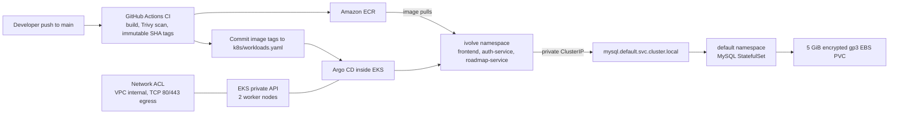

# Delivery Architecture and Retirement Plan

## Current delivery flow

```text
Application source push to main
        |
        v
GitHub Actions CI (GitHub-hosted runner)
  build three images -> Trivy scan -> push immutable SHA tags to ECR
        |
        v
Commit image tags to k8s/workloads.yaml
        |
        v
Argo CD watches main/k8s and syncs the private EKS cluster
```

GitHub Actions has no Kubernetes API permissions. It assumes the AWS OIDC role only to push images to ECR. Argo CD performs CD from inside EKS. App Services are `ClusterIP`; the EKS API is private.

## Verified state (2026-11-22)

- GitHub Actions run for commit `930b14a` succeeded, including image build/scan/push and manifest update.
- Argo CD v3.6.1 Application `ivolve-devops` targets the `ivolve` namespace. After commit `1f80d2d4ece5486a47da6ca8094b30a19820474d` was pushed, a hard refresh read that revision; the Application returned to `Synced` and `Healthy`.
- `auth-service`, `frontend`, and `roadmap-service` run in namespace `ivolve`; the latest CloudShell check showed all three Deployments and Pods `1/1` Ready. Their Services are `ClusterIP`.
- MySQL is running as StatefulSet `mysql`. PVC `mysql-data-mysql-0` is Bound to a 5 GiB encrypted gp3 EBS volume. Service `mysql` selects `mysql-stateful`.
- MySQL remains in `default` as StatefulSet `mysql` (`1/1`). PVC `mysql-data-mysql-0` is Bound to a 5 GiB encrypted gp3 EBS volume. Service `mysql` selects `mysql-stateful`; the database and secret remain in `default`. The old Deployment `mysql` is scaled to zero (`0/0`); the StatefulSet serves traffic. The source and restored `ivolve.users` row counts matched at zero, and the full database was dumped and restored before cutover.
- EKS has two `t3.small` workers with an 11-Pod limit each. The project uses one Argo Application and no Dex/OIDC SSO or notifications. The optional ApplicationSet, Notifications, and Dex deployments are scaled to zero; the bootstrap script preserves this capacity-aware configuration.
- No Ansible configuration exists in the repository.

## Jenkins retirement completed

The reviewed Terraform plan contained exactly 10 deletes: the Jenkins EC2, IAM role/profile and SSM attachment, key pair and security group, temporary EKS access entry/policy, `DescribeCluster` policy, and Jenkins-to-EKS ingress rule. It contained no changes to EKS, node groups, VPC, ECR, GitHub OIDC, or EBS resources. Applying the saved plan completed with `0 added, 0 changed, 10 destroyed`.

Post-apply AWS CLI verification confirmed:

- EC2 `i-0ddba871a9afde5cb` is `terminated`.
- EKS cluster `ivolve-devops-eks` remains `ACTIVE` with its API endpoint private.
- MySQL EBS volume `vol-02ffda242c6c0b421` remains `in-use`, encrypted, gp3, 5 GiB, and attached to an EKS worker.
- Terraform state no longer contains resources matching Jenkins or bootstrap access.

After the Jenkins EC2 retirement, an authorized CloudShell VPC session verified the private EKS API. The namespace migration completed on revision `1f80d2d`: Argo CD is `Synced` / `Healthy`, all three application Pods in `ivolve` are Ready, and MySQL remains on its EBS-backed StatefulSet/PVC in `default`.

## Remaining project requirements

- **Namespace:** complete. The application Deployments/Services and app ConfigMap are in `ivolve`; MySQL, its Service, Secret, ConfigMap, StatefulSet, and PVC remain in `default`. The `app-secrets` copy to `ivolve` was verified by key names without exposing values.
- **Network ACL:** Terraform created and associated restrictive ACL `acl-0dc0f5192d6438c08` with all four public/private subnets. AWS confirmed rules allowing intra-VPC traffic, TCP 80/443 egress, and TCP ephemeral return traffic; the default catch-all deny blocks unmatched IPv4 traffic. Applied successfully: 5 added, 0 changed, 0 destroyed.
- **Ingress:** intentionally omitted. The application remains internal by the user's choice.
- **Latest deployment:** Argo CD deployed revision `1f80d2d4ece5486a47da6ca8094b30a19820474d` and reached `Synced` / `Healthy`. The latest successful image CI run remains commit `930b14a`; commit `1f80d2d` changed Kubernetes/Terraform/docs paths and did not match the CI workflow path filters.

The EKS API remains private. The namespace move and Secret copy are complete. The existing Argo CD Application was updated from CloudShell VPC; `argocd/application.yaml` also records `ivolve` as its destination. No credentials or Secret values were committed.

## Final architecture overview



The original NTI brief asked for Jenkins CI, Ansible configuration, and an Ingress. The user selected GitHub Actions for CI, Argo CD for CD, and private `ClusterIP` Services instead. Jenkins and Ansible were removed from the target implementation; no public Ingress is configured. The MySQL workload stays in `default` to preserve the existing EBS-backed data during the application namespace move.

## Operational notes

- ECR repositories use immutable tags. CI reuses an existing image for a rerun of the same commit SHA.
- `app-secrets` remains a Kubernetes Secret. Never commit its values or place credentials in Terraform variables.
- The Argo CD UI is not exposed publicly.

## Setup and day-to-day operations

### Run the application locally

From the repository root, Docker Compose starts the application stack:

```powershell
docker compose up --build
```

Stop it with `Ctrl+C`, then run `docker compose down`. This local stack is separate from the AWS deployment.

### Infrastructure changes

Use a valid AWS CLI profile for account `397845934845` in `us-east-1`. The profile's login session can expire; authenticate again with `aws login --profile root-dev --region us-east-1` when needed. Do not put AWS credentials in the repository.

```powershell
Set-Location terraform/environments/dev
$env:AWS_PROFILE = "root-dev"
terraform init
terraform validate
terraform plan -out=review.tfplan
terraform show -no-color review.tfplan
```

Review the entire plan before applying it. Only apply after the user explicitly approves that specific plan:

```powershell
terraform apply review.tfplan
```

### CI and GitOps deployment

GitHub Actions builds, scans with Trivy, and pushes images to ECR when a push to `main` changes `auth-service/**`, `frontend/**`, `roadmap-service/**`, `.dockerignore`, or the CI workflow. It can also be started manually with `workflow_dispatch`. Once CI updates the image tags in `k8s/workloads.yaml`, Argo CD watches the repository's `k8s/` directory and automatically syncs the `ivolve` namespace.

The EKS API is private. Run live cluster checks from an authorized CloudShell VPC session (or another host with VPC network access and EKS permissions), not a regular local shell:

```bash
source kubectl-connect ivolve-devops-eks --region us-east-1
kubectl get applications.argoproj.io -n argocd ivolve-devops
kubectl get deployments,pods,services -n ivolve
kubectl get statefulsets,pvc,services -n default
```

Expected steady state: Argo CD reports `Synced` / `Healthy`; the three app Deployments have one available replica each in `ivolve`; the MySQL StatefulSet is in `default` and its encrypted gp3 PVC remains `Bound`. Application Services are private `ClusterIP`; there is no public endpoint. CloudShell sessions are temporary, so reconnect and source the cluster helper again when starting a new session.

### First-time Argo CD bootstrap

The cluster is already bootstrapped. If rebuilding it, first establish the authorized private VPC connection, create the required Kubernetes Secret without putting its values in Git, and verify the EBS-backed MySQL StatefulSet/PVC. Then review and run `scripts/bootstrap-argocd.sh`; it installs Argo CD and applies `argocd/application.yaml`. Avoid rerunning bootstrap casually because it changes cluster components.
