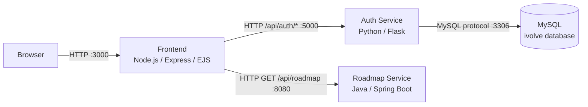

# Phase 1: Application Architecture and Implementation Plan

## Scope and source snapshot

This analysis is based on the public source repository `Ibrahim-Adel15/iVolveFinalProject`, cloned into this workspace at commit `def4818` (`Update README.md`). The checkout was shallow, but includes the complete tracked application tree at that commit. Phase 1 is source inspection only; no application code or infrastructure has been changed.

The attached NTI brief asks for a DevOps graduation project and originally lists ArgoCD for CD. The user's explicit architecture decision supersedes that requirement: Jenkins remains CI and GitHub Actions deploys directly to EKS using OIDC. ArgoCD will not be installed, configured, or used.

## Verified architecture

| Component | Verified implementation | Port | Configuration / API | Data dependency |
|---|---|---:|---|---|
| Frontend | Node.js 22 Alpine; Express 5, EJS, Axios, express-session | 3000 | `AUTH_SERVICE_URL`, `ROADMAP_SERVICE_URL`; `GET /`, `GET /signup`, `POST /signup`, `POST /login`, `GET /roadmap`, `POST /logout` | Auth and Roadmap HTTP APIs |
| Auth Service | Python 3.12; Flask 3.1.1, mysql-connector-python 9.4.0, bcrypt 4.3.0 | 5000 | Requires `DB_HOST`, `DB_PORT`, `DB_USER`, `DB_PASSWORD`, `DB_NAME`; `GET /health`, `POST /api/auth/signup`, `POST /api/auth/login` | MySQL; creates `users` table if missing |
| Roadmap Service | Java 21; Spring Boot 3.5.4, Spring Web | 8080 | `server.port=8080`; `GET /api/roadmap` | None; static response data |
| MySQL | External runtime dependency, expected database `ivolve` | 3306 | Credentials supplied to Auth Service | Stores `users` (`id`, `username`, `password_hash`, `created_at`) |

### Request and data flow

1. The browser submits login or signup forms to the Express frontend.
2. The frontend forwards JSON credentials to the Auth Service.
3. Auth checks or creates the account in MySQL. Passwords are stored as bcrypt hashes.
4. On login, the frontend stores the returned user object in an express-session cookie-backed session.
5. The frontend fetches roadmap data from the Java service and renders it through EJS.

Only the Auth Service needs direct database connectivity. MySQL should remain private to the application network. The frontend is the only externally exposed application service; Auth, Roadmap, and MySQL should use internal networking in Compose and Kubernetes.

## Source findings and risks

- The upstream README contradicts source: it labels Auth as Java and Roadmap as Python, gives incomplete/incorrect endpoint examples, and includes a plaintext-looking database credential example. Treat code as authoritative, do not repeat that credential, and correct documentation later.
- All three services already have Dockerfiles. The Roadmap Dockerfile is multi-stage; Frontend and Auth use single-stage images. The current images run as root and define no Docker `HEALTHCHECK`.
- Frontend listens on a hard-coded port and has no health endpoint. It has a weak fallback for `SESSION_SECRET`; deployment must provide a strong secret through a Kubernetes Secret/GitHub secret workflow. Its default express-session MemoryStore is not suitable for multiple replicas or durable sessions; this is a scaling limitation to document or address only if scope permits.
- Auth exposes `/health`, but it also calls `ensure_database_ready()`, which may create the table. The service initializes DB readiness on startup with retries. Database access therefore needs the DDL permission required for `CREATE TABLE` at startup, unless schema creation is separated in a future, justified change.
- Roadmap has no health endpoint or Actuator dependency. For Kubernetes probes, either use a TCP probe on port 8080 or make a small justified health endpoint change later; do not invent `/health` as if it exists.
- Runtime ports and hostnames are not configurable for the application listeners today. Compose/Kubernetes service targets must use 3000, 5000, and 8080 respectively.
- The frontend has no package lock, and its Dockerfile uses `npm install`; dependency resolution is therefore less reproducible than a lockfile-based install. Python requirements are exact-pinned; Maven dependency versions are controlled by the Spring Boot parent and Java version property.
- No `.dockerignore`, Compose file, Terraform, Ansible, Kubernetes manifests, Jenkins pipelines, GitHub Actions workflow, or deployment docs existed in the tracked source at this snapshot.
- `roadmap-service` response data includes a learning-roadmap item that mentions ArgoCD. This is application content, not an installed controller. Decide during implementation whether to minimally update that displayed text to GitHub Actions so the final product reflects the user's architecture; no such source edit was made during Phase 1.

## Recommended implementation plan

The original repository is already organized by service. Preserve that source layout and add clearly named infrastructure and delivery directories at the repository root rather than moving application code unnecessarily.

### Phase 2 — Docker and local Compose

- Improve the three existing Dockerfiles with non-root runtime users, deterministic installs where practical, and build-time/runtime health checks only where supported by actual endpoints.
- Add `.dockerignore`, `docker-compose.yml`, and `.env.example`.
- Use a private Compose network and MySQL persistent volume; publish only the frontend port by default.
- Configure startup dependencies with health conditions where compatible. Do not put actual credentials in tracked files.
- Run `docker compose config`, build images, and verify service connectivity when Docker is available.

### Phase 3 — Terraform

- Create reusable network, Jenkins EC2, EKS, and ECR modules, with EKS nodes in two private AZ subnets and exactly two initial workers.
- Add separate S3 backend bootstrap with versioning, encryption, access controls, and a supported state-locking design.
- Keep credentials external; produce safe plans/instructions only. Never apply or destroy without explicit approval.
- Run formatting, initialization, validation, and planning only when tool availability and credentials/permissions allow; report any blocked validation.

### Phase 4 — Ansible

- Use roles for common packages, Java, Docker, Jenkins, and Trivy, with an AWS EC2 dynamic inventory and idempotent tasks.
- Keep sensitive values in Ansible Vault templates/files excluded from Git.
- Run YAML and Ansible syntax/inventory checks if the tools are available.

### Phase 5 — Kubernetes

- Add the `ivolve` namespace, ConfigMap, secret example, Deployments and Services for all services, MySQL StatefulSet/headless Service/PVC, StorageClass, and frontend Ingress.
- Expose only the frontend; use EBS CSI-compatible storage and resource requests/limits.
- Use actual endpoint probes: Auth `/health`; Roadmap TCP probe unless a health endpoint is intentionally added; frontend TCP probe unless one is intentionally added.
- Validate names, selectors, ports, references, and manifests before deployment.

### Phase 6 — Jenkins CI

- Add a reusable shared-library step and one Jenkinsfile per service.
- Build, scan with Trivy, push to ECR using immutable Git-SHA tags, clean local images, update manifests, and push the manifest change.
- Trigger the GitHub Actions deployment workflow only after a successful manifest push, using a narrowly scoped mechanism.

### Phase 7 — GitHub Actions CD

- Add a manually dispatchable workflow and an explicit Jenkins trigger path.
- Authenticate to AWS with GitHub OIDC, configure EKS access, validate/apply manifests, wait for rollouts, and check deployment/pod status.
- Document the IAM trust policy, minimum permissions, repository variables/secrets, failure diagnostics, and rollback procedure.
- Do not add ArgoCD resources or dependencies.

### Phase 8 — Documentation and end-to-end review

- Correct the upstream README architecture, remove unsafe credential examples, document setup and operational workflows, add diagrams and troubleshooting, and include cleanup guidance.
- Update a progress checklist at each phase, record concrete validation results, and list unresolved limitations.

## Phase 1 completion and validation record

- Inspected the tracked service source, package/dependency declarations, existing Dockerfiles, app configuration, endpoints, database usage, and repository README.
- Confirmed the source commit with `git log -1 --oneline` and enumerated tracked files with `git ls-files`.
- No builds, tests, Docker commands, infrastructure commands, or external AWS operations were run. Phase 1 did not request execution validation, and no runtime behavior is claimed as tested.
- Files added for this phase: `AGENTS.md` and `PHASE1_ARCHITECTURE.md`.
