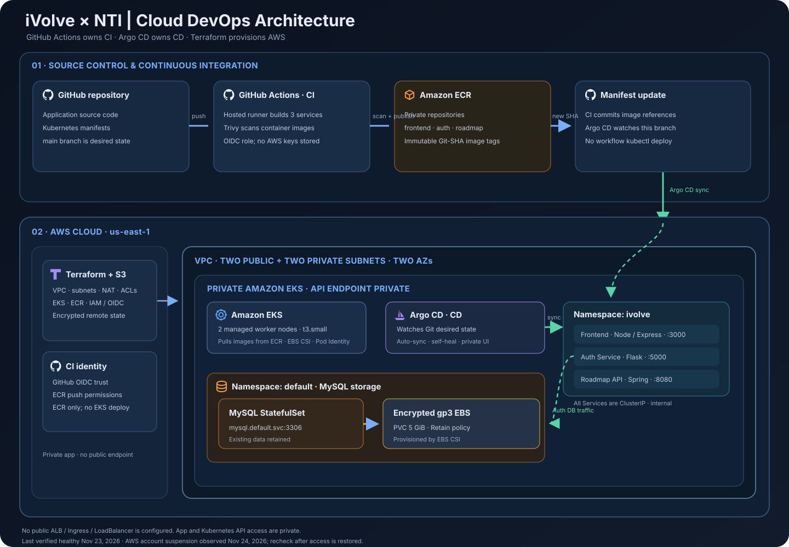

# Cloud DevOps Project

An NTI and iVolve training project that packages a small microservices application and delivers it to Amazon EKS using Terraform, GitHub Actions, Amazon ECR, and Argo CD.

## Contents

- [Project status](#project-status)
- [Architecture](#architecture)
- [Application components](#application-components)
- [Repository layout](#repository-layout)
- [CI and GitOps deployment](#ci-and-gitops-deployment)
- [Kubernetes and persistent data](#kubernetes-and-persistent-data)
- [AWS infrastructure](#aws-infrastructure-managed-by-terraform)
- [Operations command reference](#operations-command-reference)
- [Handoff checklist](#handoff-checklist)

## Project status

- **CI/CD design:** GitHub Actions builds, scans, and publishes container images; Argo CD deploys them to EKS from the Kubernetes manifests in Git.
- **Application:** frontend, authentication, and roadmap services are deployed in Kubernetes namespace **ivolve**.
- **Database:** MySQL runs separately in **default** as a StatefulSet and stores its data on an encrypted, persistent EBS volume.
- **Network exposure:** the EKS API is private, and application Services are **ClusterIP**. There is no public application URL, Ingress, or LoadBalancer in this project configuration.
- **Architecture decision:** Jenkins and Ansible were excluded from the final implementation. GitHub Actions is used for CI and Argo CD for CD.

### Latest verification and AWS account status

The following checks were observed on **November 23, 2026**:

- The GitHub Actions workflow run manually started at commit **da531d1** completed successfully, including all three image jobs and the Argo CD manifest update job.
- Argo CD reported Application **ivolve-devops** as **Synced** and **Healthy**.
- **auth-service**, **frontend**, and **roadmap-service** each had one Ready Pod in **ivolve**.
- The MySQL StatefulSet was **1/1** Ready, and PVC **mysql-data-mysql-0** was **Bound**.
- A smoke test returned HTTP **302** for signup, **302** for login, and **200** for the authenticated Roadmap page. The temporary test account was deleted, and the PVC remained Bound.
- The retired zero-replica MySQL Deployment object was deleted; the MySQL StatefulSet and PVC were retained.

On **November 24, 2026**, the AWS sign-in page showed the account as suspended. The Billing and Cost Management Payments page showed **$0.00** outstanding and no payments due. The suspension reason was not established from those pages, and EKS has not been rechecked since the suspension appeared. AWS account support may need to resolve it before AWS resources or future deployments can be managed. See [AWS guidance for suspended accounts](https://repost.aws/knowledge-center/reactivate-suspended-account).

The repository remains available independently of AWS. Do not describe the live AWS application as currently reachable until the account is reactivated and the cluster is checked again.

## Architecture

### Request flow

1. A user reaches the frontend on port **3000** from a network path inside the cluster or VPC.
2. The frontend forwards signup and login requests to the Auth Service on port **5000**.
3. The Auth Service stores users in the **ivolve** MySQL database. Passwords are stored as bcrypt hashes.
4. After login, the frontend keeps the user session in its Express session store.
5. The frontend requests roadmap data from the Roadmap Service on port **8080**.

Only the Auth Service connects directly to MySQL. The database, Auth Service, and Roadmap Service are not exposed publicly.

## Application components

| Component | Implementation | Container port | Responsibility |
|---|---|---:|---|
| Frontend | Node.js 22, Express 5, EJS | 3000 | Login/signup pages, session handling, and forwarding requests to backend services |
| Auth Service | Python 3.12, Flask, MySQL Connector, bcrypt | 5000 | User registration, login, password hashing, and MySQL access |
| Roadmap Service | Java 21, Spring Boot 3.5 | 8080 | Returns DevOps roadmap data |
| MySQL | MySQL 8.4 | 3306 | Stores records in the **ivolve.users** table |

### HTTP routes

| Service | Method | Route | Purpose |
|---|---|---|---|
| Frontend | GET | / | Login page, or redirect to Roadmap for a logged-in session |
| Frontend | GET | /signup | Signup page |
| Frontend | POST | /signup | Forwards signup data to Auth |
| Frontend | POST | /login | Forwards credentials to Auth and starts a frontend session |
| Frontend | GET | /roadmap | Authenticated Roadmap page |
| Frontend | POST | /logout | Ends the frontend session |
| Auth | GET | /health | Checks Auth and database readiness |
| Auth | POST | /api/auth/signup | Creates a user and bcrypt password hash |
| Auth | POST | /api/auth/login | Validates user credentials |
| Roadmap | GET | /api/roadmap | Returns roadmap data |

The frontend uses **AUTH_SERVICE_URL**, **ROADMAP_SERVICE_URL**, and **SESSION_SECRET**.

The Auth Service uses **DB_HOST**, **DB_PORT**, **DB_NAME**, **DB_USER**, and **DB_PASSWORD**.

## Repository layout

~~~text
.
├── auth-service/                   # Flask authentication service and Dockerfile
├── frontend/                       # Express/EJS web UI and Dockerfile
├── roadmap-service/                # Spring Boot roadmap API and Dockerfile
├── k8s/
│   ├── workloads.yaml              # Services and Deployments; app namespace is ivolve
│   └── storage.yaml                # Encrypted gp3 StorageClass and MySQL StatefulSet
├── argocd/
│   └── application.yaml            # Argo CD Application definition
├── terraform/
│   ├── bootstrap-state/             # Encrypted/versioned S3 state bucket setup
│   ├── environments/dev/            # Dev environment and remote backend
│   └── modules/                     # Network, ECR, and EKS modules
├── scripts/
│   ├── bootstrap-argocd.sh          # Installs Argo CD and applies the Application
│   ├── migrate-mysql-stateful.sh    # Backs up/restores MySQL to persistent EBS
│   ├── prepare-ivolve-namespace.sh  # Copies Secret keys to ivolve without printing values
│   └── update-image-tags.py         # Updates manifest tags to a Git SHA
├── .github/workflows/ci.yml         # Build, scan, push, and GitOps tag update
├── docker-compose.yml               # Local development stack
└── .env.example                     # Placeholder-only local environment template
~~~

## CI and GitOps deployment

### GitHub Actions CI

Workflow file: **.github/workflows/ci.yml** — **Build, scan, and publish images**.

On a push to **main**, the workflow runs when application code, **.dockerignore**, or the workflow itself changes. It can also be started with **workflow_dispatch**.

For each service, it:

1. Builds the Docker image using that service's Dockerfile.
2. Assumes an AWS IAM role through GitHub OIDC; no long-lived AWS access key is stored in GitHub.
3. Scans the image with Trivy for **HIGH** and **CRITICAL** findings that have fixes available. Findings matching the configured failure criteria fail the job.
4. Pushes the image to ECR with the full Git commit SHA as an immutable tag. A rerun reuses an image already published for the same SHA.

After all image jobs pass, the workflow updates **k8s/workloads.yaml** to use the SHA tag and pushes that manifest change to **main**. The required GitHub repository Actions variable is **AWS_ROLE_ARN**; it contains an IAM role ARN, not a password.

### Argo CD CD

**argocd/application.yaml** defines Application **ivolve-devops**. Argo CD runs inside the private cluster, watches the **k8s/** directory on **main**, and automatically syncs changes to namespace **ivolve**. Automated pruning and self-healing are enabled.

GitHub Actions does not have Kubernetes API access and does not directly deploy to EKS. EKS has a private-only API endpoint, so live cluster administration must come from an authorized host inside the VPC or a connected network.

### Current network exposure

- Kubernetes application Services use **ClusterIP**.
- No public Ingress or LoadBalancer is defined.
- The EKS API endpoint is private-only.
- The Argo CD UI is not publicly exposed.
- A public application URL has not been configured.

## Kubernetes and persistent data

- Application Deployments and Services run in namespace **ivolve**, one replica per service.
- The application Secret **app-secrets** exists in both **default** (for MySQL) and **ivolve** (for the Auth and Frontend pods). It contains **MYSQL_PASSWORD**, **MYSQL_ROOT_PASSWORD**, and **SESSION_SECRET**; values must never be committed or printed.
- The MySQL Service is **mysql** in namespace **default**. Application pods connect to **mysql.default.svc.cluster.local:3306**.
- MySQL runs as StatefulSet **mysql** in **default**.
- StorageClass **gp3-encrypted** provisions encrypted gp3 EBS volumes with reclaim policy **Retain**.
- The database PVC is **mysql-data-mysql-0**, sized 5 GiB. At the last check it was **Bound**.
- The database was backed up and restored to the EBS-backed StatefulSet before the MySQL Service was switched. The source and restored **users** row counts matched at migration.

The database data is not stored in the Git repository. A PVC has lifecycle and recovery implications: do not delete the PVC or its EBS volume when cleaning up unrelated Kubernetes resources.

## AWS infrastructure managed by Terraform

The development environment is defined in **terraform/environments/dev** and uses the modules under **terraform/modules**.

- **VPC:** CIDR **10.20.0.0/16**, two public subnets and two private subnets across two Availability Zones, Internet Gateway, and one NAT Gateway.
- **Network ACL:** Terraform-managed ACL associated with all four project subnets. It allows intra-VPC traffic and the configured web egress/return traffic.
- **EKS:** Kubernetes **1.35**, cluster API private-only, and a managed worker node group of two **t3.small** Amazon Linux 2023 nodes.
- **EKS add-ons:** Pod Identity Agent and AWS EBS CSI Driver. The CSI driver uses a dedicated IAM role for EBS volume management.
- **ECR:** one repository per application service, immutable tags, encryption, scan-on-push, and a lifecycle policy retaining the ten most recent images.
- **GitHub OIDC:** repository- and **main**-branch-scoped trust policy with ECR push permissions for CI.
- **Terraform state:** encrypted, versioned, public-access-blocked S3 backend with lockfile support.

Resources such as the EKS control plane, worker nodes, NAT Gateway, EBS volumes, ECR storage, and network data transfer can incur AWS charges. The project has no public LoadBalancer configured.

The infrastructure is account-specific. Recreating it in another AWS account requires a compatible Terraform state backend, AWS OIDC trust and IAM role, GitHub **AWS_ROLE_ARN** variable, and matching ECR registry references. The MySQL PVC in one AWS account does not automatically move to another account.

## Run locally with Docker Compose

Requirements: Docker Desktop with Docker Compose enabled.

From the repository root, create a private local environment file from the placeholders:

~~~powershell
Copy-Item .env.example .env
~~~

Edit **.env** and set unique local values for all passwords and the session secret. Do not commit **.env**; it is ignored by **.gitignore**.

Start the stack:

~~~powershell
docker compose up --build -d
docker compose ps
~~~

Open **http://localhost:3000** in a browser. Docker Compose publishes only the Frontend port to the host; backend services and MySQL stay on the internal Compose network.

Stop the stack while keeping the local MySQL named volume:

~~~powershell
docker compose down
~~~

Deleting the Compose volume removes the local database contents. Do not add the **-v** option unless you intend to discard that local data.

## Terraform workflow

Terraform changes affect real AWS resources and may incur cost. Review the full plan before applying infrastructure changes. The backend bucket must already exist; its setup code is under **terraform/bootstrap-state**.

~~~powershell
Set-Location terraform/environments/dev
$env:AWS_PROFILE = "root-dev"
terraform init
terraform validate
terraform plan -out=review.tfplan
terraform show -no-color review.tfplan
~~~

Only apply a reviewed plan when the AWS account is active and the intended changes are understood:

~~~powershell
terraform apply review.tfplan
~~~

Never commit Terraform state, saved plans, credentials, **.tfvars** files containing secrets, or real **.env** values.

## Operational checks

Run these commands in AWS CloudShell with connectivity to the cluster VPC, or another authorized in-VPC host:

~~~bash
source kubectl-connect ivolve-devops-eks --region us-east-1
kubectl get application ivolve-devops -n argocd
kubectl get deployments,pods,services -n ivolve
kubectl get statefulsets,pvc,services -n default
~~~

Expected healthy state:

- Argo CD Application is **Synced** and **Healthy**.
- All three application Deployments and Pods are Ready in namespace **ivolve**.
- MySQL StatefulSet is Ready in **default**.
- PVC **mysql-data-mysql-0** is **Bound**.
- The retired Deployment object named **mysql** is absent; the StatefulSet is the database workload.

The local machine's normal kubeconfig may not reach this cluster because the EKS endpoint is private. CloudShell sessions are temporary; reconnect and source **kubectl-connect** in each new session.

## Security and known limitations

- Do not commit AWS credentials, GitHub tokens, database passwords, session-secret values, Terraform state, or actual **.env** files.
- Kubernetes credentials are read from **app-secrets**; the manifests refer to Secret keys without embedding values.
- GitHub Actions uses OIDC with scoped ECR permissions instead of long-lived AWS keys.
- Auth hashes passwords with bcrypt. MySQL and the backend APIs remain private.
- The application uses Express's in-memory session store and one frontend replica. This is suitable for a small demonstration, not a horizontally scaled production session architecture.
- The current internal-only app has no public URL or TLS endpoint.
- AWS account suspension was shown on November 24, 2026 even though the Payments page showed no outstanding balance. The suspension reason is unknown; current EKS reachability and future AWS deployments need revalidation after AWS resolves the account status.

## User-approved scope choices

The initial training brief included Jenkins, Ansible, and externally reachable application components. The final architecture followed the later project decision:

- GitHub Actions is CI.
- Argo CD is CD.
- Jenkins and its EC2 host were retired.
- Ansible configuration was not retained.
- Application Services and the EKS API remain private.
- Existing MySQL data was retained on encrypted EBS-backed storage while application workloads moved to namespace **ivolve**.

These choices define the delivered project scope; explain them during handoff if they differ from the original brief.

## Operations command reference

Use the commands below as a runbook. Replace only values explicitly marked as examples. Never paste credential values into a terminal transcript or commit them. The AWS account was shown suspended on November 24, 2026; AWS commands may fail until the account owner resolves access. The cluster status below is last-known evidence, not a live check.

### 1. Clone the repository and run the app locally

Run in PowerShell. Docker Desktop must be running.

~~~powershell
git clone https://github.com/abdelazizamer/iVolveFinalProject.git
Set-Location .\iVolveFinalProject
Copy-Item .env.example .env
~~~

Edit `.env` locally. Set unique development passwords and a session secret; do not reuse cloud values. You can generate a session secret, then paste it into `.env` yourself:

~~~powershell
python -c "import secrets; print(secrets.token_urlsafe(48))"
~~~

Validate the Compose file, build the images, and start the stack:

~~~powershell
docker version
docker compose version
docker compose config -q
docker compose up --build -d
docker compose ps
~~~

Open `http://localhost:3000`. The login page should return HTTP 200:

~~~powershell
(Invoke-WebRequest http://localhost:3000/ -UseBasicParsing).StatusCode
~~~

Follow logs or inspect a startup failure:

~~~powershell
docker compose logs --tail 100 frontend auth-service roadmap-service mysql
docker compose logs -f frontend
~~~

Stop the containers and retain the database volume:

~~~powershell
docker compose down
~~~

Do not add `-v` unless you intend to delete the local MySQL volume and its data.

### 2. Change code and trigger CI

The workflow is `.github/workflows/ci.yml`. A push to `main` starts it when `auth-service/**`, `frontend/**`, `roadmap-service/**`, `.dockerignore`, or the workflow changes. README-only and Kubernetes-manifest-only commits do not match the push path filter. The workflow can also be started manually from **GitHub → Actions → Build, scan, and publish images → Run workflow**.

Example: stage a Roadmap service change. For other services, substitute `auth-service/` or `frontend/`.

~~~powershell
Set-Location (git rev-parse --show-toplevel)
git status --short
git add roadmap-service/
git diff --cached --check
git diff --cached
git commit -m "Describe the application change"
git push origin main
~~~

Review the staged diff before committing. Do not stage `.env`, credentials, Terraform state, or plans. If the remote has commits you do not have, rebase and push again; do not force-push:

~~~powershell
git pull --rebase origin main
git push origin main
~~~

With GitHub CLI installed and authenticated, inspect workflow status and failed logs:

~~~powershell
gh auth status
gh workflow list
gh run list --workflow ci.yml --limit 5
$runId = gh run list --workflow ci.yml --limit 1 --json databaseId --jq '.[0].databaseId'
gh run view $runId --log-failed
~~~

CI builds each image, scans for configured HIGH/CRITICAL Trivy findings, and pushes immutable full-SHA tags to ECR. After all three image jobs succeed, the workflow updates `k8s/workloads.yaml`. Argo CD then syncs that Git change; CI does not run `kubectl`. If OIDC/ECR fails, verify the repository Actions variable `AWS_ROLE_ARN`, the IAM trust subject for this repository and `main`, and the failed workflow step. Do not create long-lived AWS access keys for the workflow.

### 3. Connect to EKS and check Argo CD

Run in AWS CloudShell configured for VPC connectivity, or another authorized host inside the VPC. The EKS API endpoint is private.

~~~bash
source kubectl-connect ivolve-devops-eks --region us-east-1
kubectl config current-context
kubectl get nodes -o wide
kubectl get application ivolve-devops -n argocd
kubectl get deployments,pods,services -n ivolve
kubectl get statefulsets,pods,services,pvc -n default
~~~

Last observed healthy state: Argo CD `Synced / Healthy`; three application Deployments had one Ready replica each in `ivolve`; MySQL StatefulSet was `1/1` and its PVC `Bound`. Recheck these commands after AWS access returns; do not treat historical output as current.

Refresh Argo CD's view and inspect reconciliation status:

~~~bash
kubectl annotate application ivolve-devops -n argocd argocd.argoproj.io/refresh=hard --overwrite
kubectl get application ivolve-devops -n argocd -o wide
kubectl describe application ivolve-devops -n argocd
~~~

Inspect workloads and recent events:

~~~bash
kubectl get pods -n ivolve -o wide
kubectl logs deployment/frontend -n ivolve --tail=100
kubectl logs deployment/auth-service -n ivolve --tail=100
kubectl logs deployment/roadmap-service -n ivolve --tail=100
kubectl get events -n ivolve --sort-by=.lastTimestamp
~~~

For a specific pod, first obtain its exact name with `kubectl get pods -n ivolve`, then run `kubectl describe pod POD_NAME -n ivolve`. Never print the contents of Kubernetes Secrets.

The app has no public URL. To make a temporary private check from CloudShell, run this in one terminal:

~~~bash
kubectl port-forward --address 127.0.0.1 -n ivolve svc/frontend 18080:3000
~~~

In another terminal in the same CloudShell environment:

~~~bash
curl -i http://127.0.0.1:18080/
~~~

Expect HTTP 200 for the login page. Stop the port-forward with `Ctrl+C`. This does not expose a public endpoint.

### 4. Check MySQL and persistent storage safely

~~~bash
kubectl get statefulset mysql -n default
kubectl get pods -n default
kubectl get pvc mysql-data-mysql-0 -n default
kubectl get service mysql -n default -o jsonpath='{.spec.selector}{"\n"}'
kubectl get secret app-secrets -n ivolve -o jsonpath='{.data}' | jq 'keys'
~~~

Expected last-known state: StatefulSet `1/1`, PVC `Bound`, and service selector points to the MySQL StatefulSet. The final command prints Secret key names only. Do not use `kubectl get secret ... -o yaml`, delete the PVC/EBS volume, or rerun the completed `scripts/migrate-mysql-stateful.sh` against the live cluster.

### 5. Inspect Terraform without changing AWS

Run in PowerShell from a repository checkout. Set the profile to the profile configured on your machine; it must have access to the existing Terraform backend.

~~~powershell
Set-Location (git rev-parse --show-toplevel)
$env:AWS_PROFILE = "root-dev"
$env:AWS_REGION = "us-east-1"
aws sts get-caller-identity --region us-east-1
terraform fmt -check -recursive
terraform -chdir=terraform/environments/dev init
terraform -chdir=terraform/environments/dev validate
terraform -chdir=terraform/environments/dev plan -out=review.tfplan
terraform -chdir=terraform/environments/dev show -no-color review.tfplan
~~~

These commands do not apply the plan. Read every create, update, replacement, and destroy. EKS, EC2 workers, NAT Gateway, EBS, ECR storage, and data transfer can incur charges. Applying requires an active AWS account, a reviewed plan, cost/data review, and explicit approval. Never run `terraform destroy` as routine cleanup. Never commit `*.tfstate`, `*.tfplan`, credentials, or secret-bearing `*.tfvars` files.

### 6. Existing one-time scripts

These scripts change live cluster resources. Namespace setup and MySQL migration have already been completed; use them only when deliberately rebuilding and after reviewing their contents.

~~~bash
bash scripts/prepare-ivolve-namespace.sh
bash scripts/bootstrap-argocd.sh
bash scripts/migrate-mysql-stateful.sh
~~~

`scripts/update-image-tags.py` is called by CI after ECR images are published. Manual invocation is only appropriate when the matching image SHA tags exist in ECR.

### 7. Quick troubleshooting map

| Symptom | Commands to start with |
|---|---|
| Docker is unavailable | `docker version`; open Docker Desktop and retry. |
| Compose container is unhealthy | `docker compose ps`; `docker compose logs --tail 100 SERVICE`. |
| Git push is rejected | `git pull --rebase origin main`, inspect conflicts, then push. |
| OIDC/ECR access denied | Inspect failed CI step, `AWS_ROLE_ARN`, IAM OIDC trust subject, and repository/region configuration. |
| kubectl cannot connect | Reconnect through VPC-enabled CloudShell and source `kubectl-connect`; check AWS account status. |
| Argo CD is OutOfSync/Degraded | `kubectl describe application ivolve-devops -n argocd`; inspect pods and events. |
| MySQL/PVC issue | `kubectl get pvc -n default`; `kubectl describe pvc mysql-data-mysql-0 -n default`; inspect `mysql-0` logs. Preserve the PVC. |

## Handoff checklist

- [ ] GitHub Actions CI is green for the latest application commit.
- [ ] Argo CD reports `Synced` and `Healthy` after AWS access is restored.
- [ ] The three app Deployments are Ready in `ivolve`.
- [ ] MySQL StatefulSet is Ready and its PVC remains `Bound` in `default`.
- [ ] README and architecture diagram match the actual environment.
- [ ] No secrets, local environment files, or Terraform state were committed.
- [ ] Explain that the app currently has no public link and the AWS account was reported suspended on November 24, 2026.
